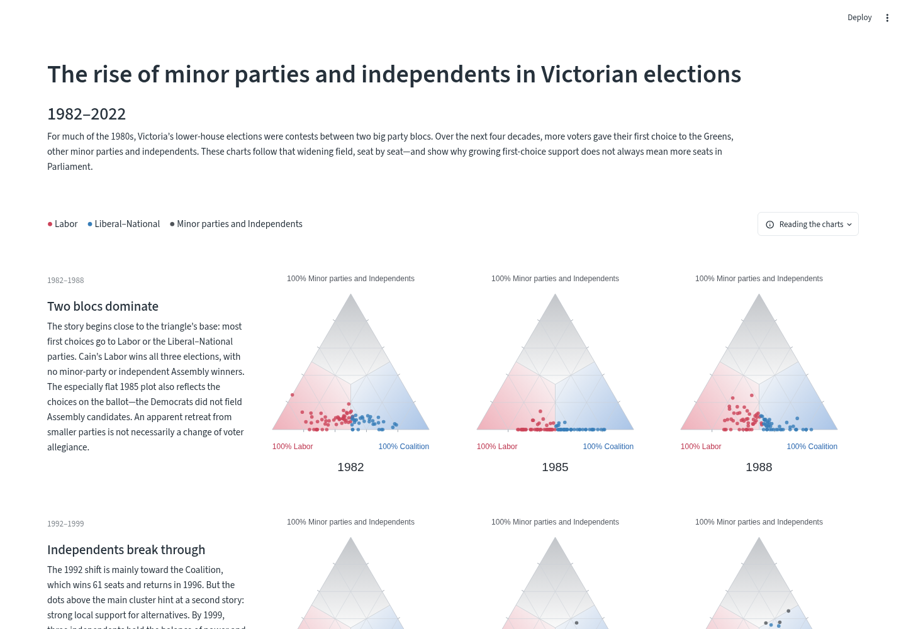

# The rise of minor parties and independents in Victorian elections

1982–2022

A Streamlit + Apache ECharts gallery of Victorian Legislative Assembly first preferences, 1982–2022.



## Run

Python 3.12 recommended.

```sh
cd vic-elections
python -m pip install -r requirements.txt
python -m streamlit run app.py
```

To install the official, version-matched Streamlit agent skill in your checkout:

```sh
python -m streamlit skills --yes
```

The skill is installed in this working checkout. Its environment-specific symlink is intentionally ignored by Git. [Streamlit skill documentation](https://docs.streamlit.io/develop/api-reference/cli/skills).

## Reading the gallery

- One circle per seat, positioned by **first-preference shares** for Labor, Liberal/National Coalition and Minor parties and Independents.
- Colour represents the **winning group after preferences**: Labor (red), Liberal–National (blue), Minor parties and Independents (dark grey). This includes Greens and independent winners.
- All circles use 80% opacity. Hover for the seat name and three reference lines, with vote shares at the edges.
- Light grey rules and four unlabelled ticks per edge mark 20, 40, 60 and 80%. The triangle is equilateral at every component width.
- Three charts per row, with a context column on the left, across four historical periods. Equal 1:1:1:1 columns inside a 1,600px page bound preserve the previous triangle size at laptop widths. Years are centred below each plot. Narrower screens stack the columns. The app uses a white theme.

The page contains only the gallery, researched explanations and a compact reading/data popover. The windsock map, data/methods tabs and three-candidate controls have been removed from the app. Earlier research files and chart helpers remain in the repository as working material.

## Historical explanations

Four three-election periods tell the story of first choices gradually spreading beyond the major parties:

1. **1982–1988: Two blocs dominate.** Labor wins all three elections. The flat 1985 plot also reflects the Democrats not fielding Assembly candidates.
2. **1992–1999: Independents break through.** Coalition victories give way to a hung parliament in which three independents back a minority Labor government.
3. **2002–2010: The field opens up.** Rising Greens support does not immediately translate into Assembly seats, while government changes hands.
4. **2014–2022: Support broadens.** A wider range of first choices accompanies Greens breakthroughs, uneven independent success and continuing Labor majorities.

Text and research links live in `data/election_context.json`. Sources include the Victorian Parliament’s *Visualising Victoria’s electoral history*, its 2022 election report, the Australian Election Archive and the VEC. Source links are retained for research traceability but not printed under the on-page descriptions. Parliamentary PDFs are retained under `research/context/`.

The reading helper explicitly explains the three shares, how to read positions and gridlines, and why a ternary plot reveals votes outside the major blocs that a two-party comparison would hide. It distinguishes first-preference position from final winner colour.

## Data and limits

The gallery contains 1,049 seat-election rows across 12 elections. Historical primary figures come from electorate result tables citing election reports. Official VEC 2022 preference distributions supply the 2022 first-preference figures. Exact source URLs and winning party/candidate fields are retained in `data/first_preferences.csv`.

**19 historical tables fail candidate-sum versus published-formal-total reconciliation.** Their shares use the candidate sum. An asterisk on the hovered name flags these seats; the reading popover can exclude them. Historical coverage remains provisional rather than representing every raw count as independently verified.

Minor parties and Independents includes Greens and other candidates with differing politics. Seat boundaries and ballot choices change over time, so these are not the same voters tracked across elections. 2022 includes Narracan’s January 2023 supplementary election. There are no 2026 results: the election had not occurred at compilation on 25 November 2026.

Additional workbooks, final 2PP/2CP counts, intermediate 2022 rounds and map files from earlier work remain available in `data/` and `research/`. They are not loaded or displayed by this app.

## Live deployments

The app executes the current `charts.py` source in an isolated module on each run. This avoids stale helper functions surviving a Community Cloud code update. CSV and context-file versions are included in the data-cache key, so corrected values and changed explanations refresh after deployment.

## Checks

```sh
python -m pip install -r requirements-dev.txt
python -m unittest discover -p 'test_*.py'
python -m ty check app.py charts.py
```

Tests cover vote sums, winner grouping, equal triangle sides, 80% circle opacity, ticks and hover projections, plus stale-module and data-cache updates. Visual checks at 1440px and 1366px confirm three charts per row across four rows, left-hand descriptions, bottom-centred years, preserved triangle size, a white background and no browser errors. A phone-width check verifies wrapping. The Streamlit agent API is enabled only on the internal QA server, never in deployment configuration.

To repeat the screenshot checks against a running app:

```sh
python capture.py --url http://127.0.0.1:8501
```

Deploy on Streamlit Community Cloud with `app.py` as the entry point. The app has no external API or database dependency.
