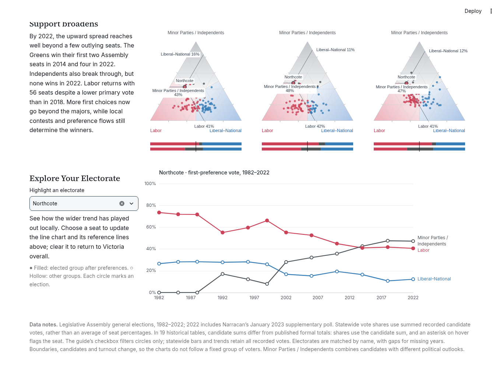

# The Rise of Minor Parties and Independents in Victorian Elections

1982–2022

A Streamlit + Apache ECharts gallery of Victorian Legislative Assembly first preferences, 1982–2022.


## Run

Python 3.12 recommended.

```sh
cd vic-elections
python -m pip install -r requirements.txt
python -m streamlit run app.py
```

To install the official, version-matched Streamlit agent skill in your checkout:

```sh
python -m streamlit skills --yes
```

The skill is installed in this working checkout. Its environment-specific symlink is intentionally ignored by Git. [Streamlit skill documentation](https://docs.streamlit.io/develop/api-reference/cli/skills).

## Reading the gallery

- One circle per seat, positioned by **first-preference shares** for Labor, Liberal/National Coalition and Minor Parties / Independents.
- Colour represents the **winning group after preferences**: Labor (red), Liberal–National (blue), Minor Parties / Independents (dark grey). This includes Greens and independent winners.
- All circles use 80% opacity. Hover for the seat name and three reference lines, with whole-percentage vote shares at the edges.
- Choose a name in **Explore Your Electorate**, at the bottom of the page, to switch the primary-vote line chart from Victoria overall to that seat. The same selection keeps the seat outlined and its guides visible in the triangles above. Clear the selection to return to statewide trends and ordinary hover. A note marks years without a displayed record; seats are not mapped across renamings or boundary changes.
- Two thin, unlabelled 100% stacked bars sit below every triangle: statewide seats won above, recorded first-preference votes below. They use the same palette, ordered Labor → Minor Parties / Independents → Liberal–National, with a 50% vertical reference. Each strip is eight pixels thick. Vote shares are weighted by vote counts, rather than averaged across seats, and both bars always use all recorded seats even when the dot filter is active.
- Light grey rules and four unlabelled ticks per edge mark 20, 40, 60 and 80%. The triangle is equilateral at every component width.
- Three charts per row, with a context column on the left, across four historical periods. Equal 1:1:1:1 columns inside a 1,600px page bound preserve the previous triangle size at laptop widths. Years are centred above each plot; axis labels use group names without a 100% prefix. Each year has its own title band, separated from the top axis label without shrinking the triangle. Narrower screens stack the columns. The app uses a white theme.

The page contains the gallery, researched explanations, an expandable reading guide and the final electorate explorer, followed by one consolidated data note. The windsock map, data/methods tabs and three-candidate controls have been removed from the app. Earlier research files and chart helpers remain in the repository as working material.

## Historical explanations

Four three-election periods tell the story of first choices gradually spreading beyond the major parties:

1. **1982–1988: Two blocs dominate.** Labor wins all three elections. The flat 1985 plot also reflects the Democrats not fielding Assembly candidates.
2. **1992–1999: Independents break through.** Coalition victories give way to a hung parliament in which three independents back a minority Labor government.
3. **2002–2010: The field opens up.** Rising Greens support does not immediately translate into Assembly seats, while government changes hands.
4. **2014–2022: Support broadens.** A wider range of first choices accompanies Greens breakthroughs, uneven independent success and continuing Labor majorities.

Text and research links live in `data/election_context.json`. Sources include the Victorian Parliament’s *Visualising Victoria’s electoral history*, its 2022 election report, the Australian Election Archive and the VEC. Source links are retained for research traceability but not printed under the on-page descriptions. Parliamentary PDFs are retained under `research/context/`.

The reading guide explains the three shares, positions and gridlines in three paragraphs, followed by an annotated dummy seat (40% Labor, 35% Liberal–National, 25% Minor Parties / Independents). Its reference lines are always visible. A parallel explanation covers the horizontal 100% bars, with a labelled dummy example. Example charts render only when the guide is open and are not part of the election dataset.

## Explore Your Electorate

Three lines show first-preference shares for each election. Victoria overall is the default: group vote counts are summed before calculating percentages. Selecting an electorate switches to its recorded shares and highlights its points in the historical triangles. Elections use proportional time spacing, with a circle at each observed election and gaps for missing seat-years.

The explorer sits directly below the gallery in a matching four-track grid: its heading, dropdown and explanation occupy the left track, and the 380px-high line chart spans the other three. The chart title is inside the plot component, so the whole explorer stays one chart row tall. One data note at the bottom covers coverage, vote weighting, flagged historical totals and changing seat boundaries.

In a selected seat, **filled circles** identify the group that won after preferences; the other groups have **hollow circles**. Circle size and party colours stay consistent. Tooltips show whole-percentage shares and the actual winning party. Statewide markers remain hollow because this view has no individual electorate winner. See [the design research](research/chart-design.md) for the guidance informing these choices.



## Data and limits

The gallery contains 1,049 seat-election rows across 12 elections. Historical primary figures come from electorate result tables citing election reports. Official VEC 2022 preference distributions supply the 2022 first-preference figures. Exact source URLs and winning party/candidate fields are retained in `data/first_preferences.csv`.

**19 historical tables fail candidate-sum versus published-formal-total reconciliation.** Their shares use the candidate sum. An asterisk on the hovered name flags these seats; the reading guide can exclude them from the triangles. Statewide bars and the explorer retain all recorded votes. Historical coverage remains provisional rather than representing every raw count as independently verified.

Minor Parties / Independents includes Greens and other candidates with differing politics. Seat boundaries and ballot choices change over time, so these are not the same voters tracked across elections. 2022 includes Narracan’s January 2023 supplementary election. There are no 2026 results: the election had not occurred at compilation on 25 November 2026.

Additional workbooks, final 2PP/2CP counts, intermediate 2022 rounds and map files from earlier work remain available in `data/` and `research/`. They are not loaded or displayed by this app.

## Theme and legends

`.streamlit/config.toml` loads `.streamlit/editorial-theme.toml`. The theme pairs Inter body text with Source Serif 4 headings, uses a white background and near-black text, and sets heading/body sizes, spacing, radii and neutral control surfaces. Google Fonts are declared through Streamlit’s native theme settings. No application CSS is required.

The party legend follows the introduction, then the reading guide. Its native ECharts example labels dummy rows **% seats** (top) and **% votes** (bottom) and identifies the 50% reference. These labels are shared across the page rather than repeated on every election plot. The electorate selector sits in the final exploration section.

## Live deployments

The app executes the current `charts.py` source in an isolated module on each run. This avoids stale helper functions surviving a Community Cloud code update. CSV and context-file versions are included in the data-cache key, so corrected values and changed explanations refresh after deployment.

## Checks

```sh
python -m pip install -r requirements-dev.txt
python -m unittest discover -p 'test_*.py'
python -m ty check app.py charts.py
```

Tests cover vote sums, winner grouping, equal triangle sides, 80% circle opacity, whole-percentage hover projections, persistent selection, missing-name years, vote-weighted summaries and trends, filled winner markers, the fictional example, and stale-module/data-cache updates. Visual checks at 1440px and 1366px confirm three charts per row across four rows, left-hand descriptions, top-centred years, preserved triangle size, a white background and no browser errors. They also check the explorer and reading guide. A phone-width check verifies wrapping. The Streamlit agent API is enabled only on the internal QA server, never in deployment configuration.

To repeat the screenshot checks against a running app:

```sh
python capture.py --url http://127.0.0.1:8501
```

Deploy on Streamlit Community Cloud with `app.py` as the entry point. The app has no external API or database dependency.
